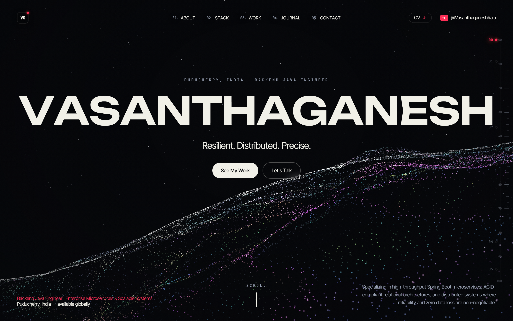
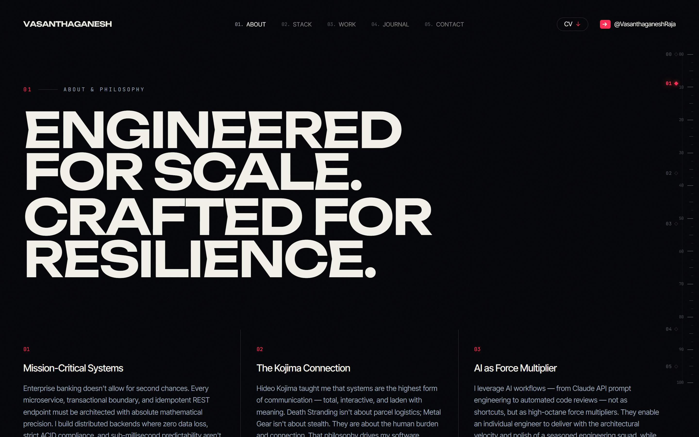
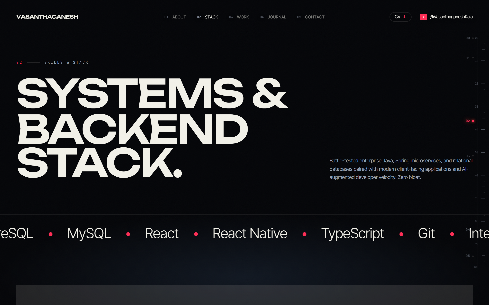
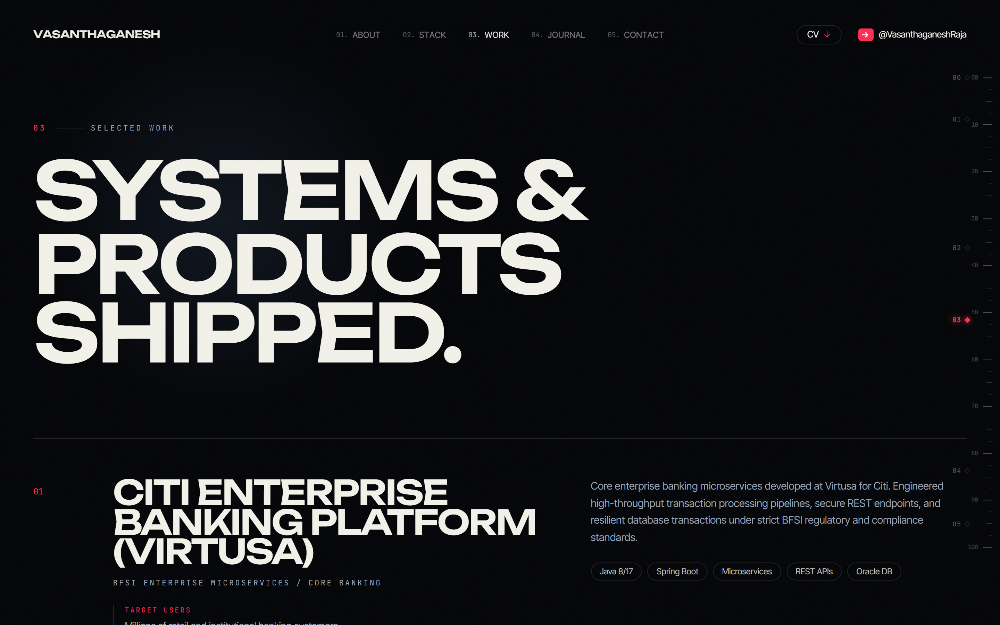
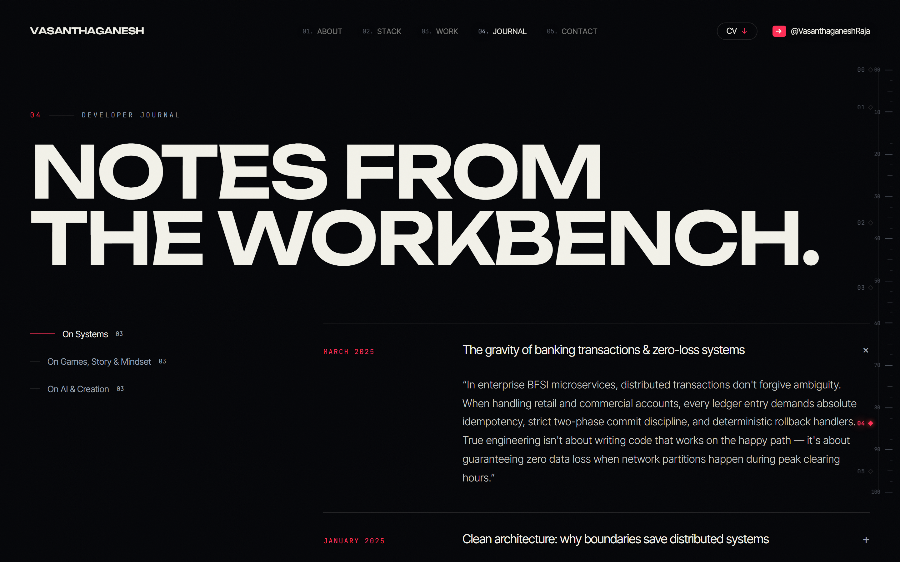
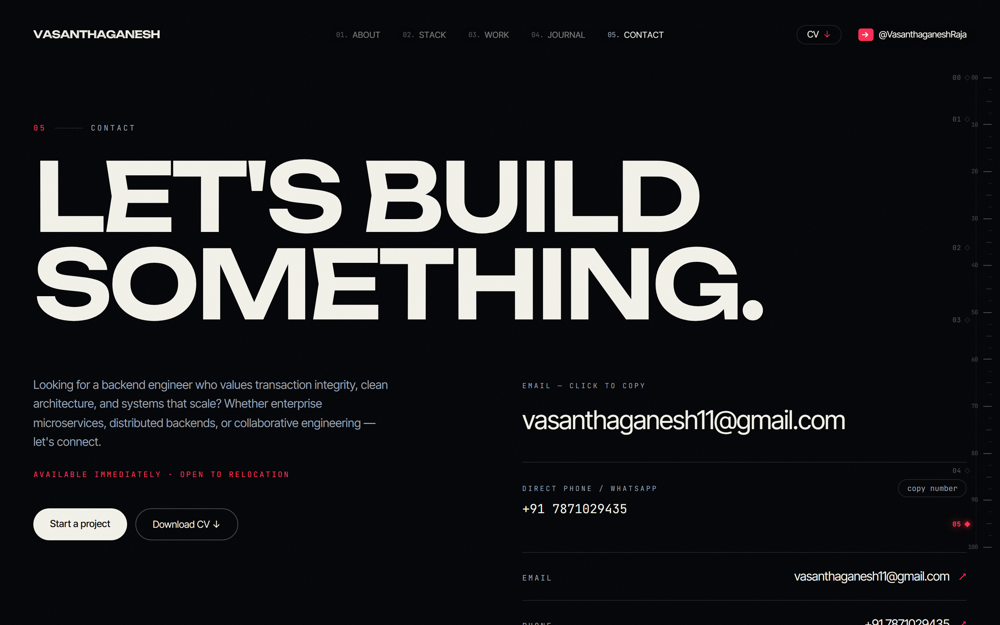

# Vasanthaganesh R — Portfolio

<p align="center">
  
</p>

<p align="center">
  <strong>Backend Java Engineer · Enterprise Microservices & Scalable Systems</strong><br />
  Puducherry, India · Available Globally
</p>

<p align="center">
  <a href="https://github.com/vasanthaganesh/Vasanthaganesh_portfolio"></a>
  <a href="https://www.typescriptlang.org/"></a>
  <a href="https://tailwindcss.com/"></a>
  <a href="https://threejs.org/"></a>
  <a href="https://www.framer.com/motion/"></a>
  
</p>

---

## 📌 Overview

This repository houses the personal portfolio and digital workbench of **Vasanthaganesh R**, an enterprise Backend Java Engineer specializing in high-throughput Spring Boot microservices, ACID-compliant relational architectures, and distributed systems where reliability and zero data loss are non-negotiable.

The portfolio is designed as an interactive, cinematic editorial space built with **Next.js 15**, **Three.js**, **Framer Motion**, and **Tailwind CSS**.

---

## 📸 Visual Tour & Key Sections

### 1. Hero & Interactive Particle Terrain
An interactive 3D particle terrain computed via Three.js with fluid camera motion and dynamic typography.
<p align="center">
  
</p>

---

### 2. Engineering Philosophy & Inspirations
Highlights core architectural beliefs, real-world systems philosophy, and foundational inspirations.
<p align="center">
  
</p>

---

### 3. Backend & Systems Tech Stack
An interactive horizontal discipline view showcasing battle-tested enterprise tools alongside modern full-stack capabilities.
<p align="center">
  
</p>

---

### 4. Selected Work & Enterprise Impact
In-depth breakdown of mission-critical systems and consumer applications, detailing target users, technical architectures, and real-world impact.
<p align="center">
  
</p>

---

### 5. Developer Journal & Technical Insights
A 3-column engineering notebook covering distributed systems, game design mindset, and AI-augmented velocity.
<p align="center">
  
</p>

---

### 6. Contact & Direct Communication
Direct channels for technical discussions, contracts, and hiring inquiries.
<p align="center">
  
</p>

---

## 🛠 Tech Stack & Core Competencies

| Domain | Technologies & Frameworks |
|---|---|
| **Core Backend** | Java (8 & 17), Spring Boot, Hibernate / JPA, Spring Security, REST APIs, Microservices |
| **Databases & Storage** | Oracle DB, PostgreSQL, MySQL, ACID Transactions, Schema Design |
| **Architecture & Reliability** | Clean Architecture, Idempotency, Event Handling, Distributed Systems |
| **Frontend & UI** | Next.js 15, React 19, TypeScript, Tailwind CSS, Three.js, Framer Motion, Lenis |
| **Tooling & Workflows** | Git, Maven, IntelliJ IDEA, VS Code, Linux, CI/CD |

---

## 🎓 Certifications & Education

* **Oracle Certified Associate (OCA)** — Java SE 8 Programmer (*Core Java, OOP, Collections, Concurrency*)
* **Claude AI Certified** — Anthropic Prompt Engineering & Agentic Workflows
* **Bachelor of Technology (B.Tech) in Information Technology** — Manakula Vinayagar Institute of Technology (MVIT) · **8.32 CGPA**

---

## 🚀 Featured Projects

* **Citi Enterprise Banking Platform (Virtusa)**: Mission-critical banking microservices handling high-throughput transaction pipelines, resilient database operations, and regulatory BFSI compliance.
* **Precision Tools Quality Control Automation**: Computer-vision and barcode-guided QC inspection system reducing manual defect rates on industrial manufacturing lines.
* **AI Reflection Journal**: Offline-first private journaling application powered by local LLM sentiment inference and zero cloud telemetry. [View Repo](https://github.com/vasanthaganesh/AI-Reflection-Journal)
* **AI Companion**: Low-latency empathetic conversational AI companion designed for ambient assistance and mood tracking. [View Repo](https://github.com/vasanthaganesh/AI_Companion)
* **Daily Vegetable Price Tracker**: Real-time mandi commodity price aggregator providing daily market index transparency for local farmers and vendors.

---

## 💻 Local Development

### Prerequisites
* Node.js 18+ (tested with Node 20 / 22 / 24)
* npm, pnpm, or yarn

### Setup
```bash
# Clone the repository
git clone https://github.com/vasanthaganesh/Vasanthaganesh_portfolio.git
cd Vasanthaganesh_portfolio

# Install dependencies
npm install

# Run development server
npm run dev
```

Visit [http://localhost:3000](http://localhost:3000) to view the application.

### Build & Static Export
```bash
# Production build & static HTML export
npm run build

# Serve exported static build
npm run start
```

### Verification & Testing
```bash
# Static type checking
npm run typecheck

# Comprehensive 4-Tier verification test suite
node scripts/verify-portfolio.mjs
```

---

## 📬 Contact & Connect

* **Email**: [vasanthaganesh11@gmail.com](mailto:vasanthaganesh11@gmail.com)
* **Phone**: +91 7871029435
* **GitHub**: [@vasanthaganesh](https://github.com/vasanthaganesh)
* **Location**: Puducherry, India

---

<p align="center">
  Crafted with precision by <strong>Vasanthaganesh R</strong> · © 2026
</p>
